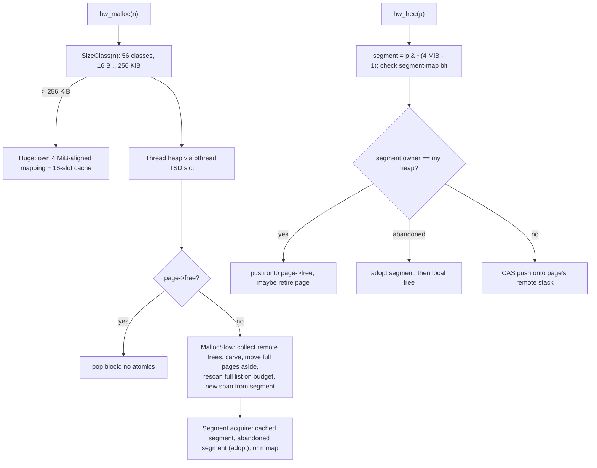

# heapwise

A general-purpose, thread-caching memory allocator for C and C++ services: per-thread heaps
with an atomic-free local path, lock-free cross-thread frees, and segment adoption when
threads exit. Benchmarked against macOS libmalloc, mimalloc, and jemalloc on allocation
traces recorded from real programs.

[](https://github.com/eshaan2418/heapwise/actions/workflows/ci.yml)
[](LICENSE)


## Why this exists

Allocation-heavy programs spend a surprising share of their time in `malloc` and `free`, and
the platform allocator is rarely tuned for their pattern. On the real-program traces below,
thread-caching allocators run the same allocation sequence up to 1.9x faster than macOS
libmalloc, and 17–25x faster on a multithreaded server-style workload. Writing an allocator
that is fast *and* returns memory correctly under cross-thread frees and thread churn means
solving the same problems mimalloc and jemalloc solve. heapwise does that in about 900 lines
and documents every decision, including where it is still slower than those two.

## Highlights

- **No atomics or locks on the local path.** 4 MiB-aligned segments let `free` find metadata
  with a mask. Pages are owned by exactly one thread heap, so local malloc and free are plain
  loads and stores.
- **Lock-free cross-thread frees.** Each page has a push-only Treiber stack on its own
  128-byte cache line. The owner takes the whole stack with a single `exchange`, so there is
  no ABA hazard.
- **Bounded memory under remote frees.** Full pages are rescanned on an amortised O(1)
  budget. An earlier heuristic let a producer's heap double every cycle (2.4 GB for 1 MB live);
  the fix and its regression test are documented.
- **Thread exit handled end to end.** Exiting threads abandon their segments. Other threads
  adopt them when they need memory or when they free into them, so the memory is reused and
  returned.
- **Measured on real programs.** A DYLD interposer records every malloc-family call from
  CPython, SQLite, jq, and ffmpeg. The traces replay identically under each allocator, in
  separate processes, gated on an idle machine.

## Quick start

macOS (Homebrew):

```sh
brew install cmake ninja googletest google-benchmark mimalloc jemalloc
git clone https://github.com/eshaan2418/heapwise && cd heapwise
make test          # build + 29 unit, property, and multithreaded tests
make demo          # replay a real SQLite trace on every allocator
```

Linux (Debian/Ubuntu):

```sh
sudo apt-get install cmake ninja-build clang libgtest-dev libbenchmark-dev libmimalloc-dev libjemalloc-dev
git clone https://github.com/eshaan2418/heapwise && cd heapwise
CC=clang CXX=clang++ make test
LD_PRELOAD=$PWD/build/libheapwise_override.so python3 -c 'print("running on heapwise")'
```

mimalloc and jemalloc are only needed for the comparison benchmarks. GoogleTest and Google
Benchmark are fetched automatically if they are not installed.

## Usage

As a library (CMake):

```cmake
add_subdirectory(heapwise)
target_link_libraries(my_service PRIVATE heapwise)
```

```c
#include <heapwise/heapwise.h>

struct order* o = hw_malloc(sizeof *o);
char* buf = hw_aligned_alloc(64, 4096);   // cache-line aligned buffer
o = hw_realloc(o, 2 * sizeof *o);
hw_free(buf);
hw_free(o);                               // any thread may free

hw_stats s;
hw_collect(1);                            // reclaim memory of exited threads now
hw_get_stats(&s);
printf("%llu bytes mapped\n", (unsigned long long)s.bytes_mapped);
```

As the process allocator on Linux:

```sh
LD_PRELOAD=/path/to/libheapwise_override.so ./my_server
HEAPWISE_HUGEPAGES=1 LD_PRELOAD=... ./my_server   # madvise(MADV_HUGEPAGE) on 4 MiB segments
```

Recording and replaying your own program's allocations (macOS):

```sh
HWTRACE_DIR=/tmp/t DYLD_INSERT_LIBRARIES=build/bench/libhwtracer.dylib ./my_program
build/bench/hw_tracecompile /tmp/t/trace.<pid>.raw my.hwt
for b in build/bench/bench_*; do $b replay my.hwt; done
```

## Architecture



A **segment** (4 MiB, aligned) holds a header in its first 64 KiB unit and 63 units for
**pages**. A page is a span of 1–32 units serving one size class. **Thread heaps** own
segments and keep, per size class, a queue of pages that still have blocks and a list of full
pages. The owner thread manipulates a page with plain memory operations. Other threads only
push onto that page's remote stack, which the owner drains with one atomic exchange when it
runs out of blocks. When a thread exits, its segments go to an abandoned list. The next
thread that needs a segment, or frees into one, adopts it.

[docs/DESIGN.md](docs/DESIGN.md) has the full layout, invariants, and a concurrency table.
[docs/DEEP_DIVE.md](docs/DEEP_DIVE.md) works through 19 hard questions about the design.

## Benchmarks

Methodology: every allocator runs as its own process, built from the same driver
(`bench/workloads.cpp`). The jemalloc binary checks `mallctl("version")` at startup to prove
jemalloc is the active allocator. Each workload ran 7 times, interleaved round-robin across
allocators. Times are medians; mean ± 95% CI and maxima are in
[bench/results/summary.md](bench/results/summary.md). Hardware: Apple M5 Pro (18 cores,
48 GB), macOS 27.0.1, Apple clang 21, mimalloc 3.6.1, jemalloc 5.4.0. Reproduce with
`make bench` (records traces, runs everything, writes `bench/results/`).

**Real-program trace replays.** These ran on an idle machine: `run.sh` waited for a 1-minute
load average below 3 before every repetition.

| trace (ops) | system | jemalloc | mimalloc | heapwise | heapwise vs system |
|---|---:|---:|---:|---:|---:|
| CPython 3.12 compiling 400 stdlib modules (13.7M) | 90.9 ms | 84.0 ms | **48.9 ms** | 52.8 ms | 1.72x |
| jq 1.8 reshaping 40k JSON records (2.7M) | 34.4 ms | 28.5 ms | **17.8 ms** | 23.4 ms | 1.47x |
| SQLite 3.53 building/querying 200k rows (0.85M) | 4.0 ms | 3.0 ms | **2.1 ms** | 2.5 ms | 1.59x |
| ffmpeg 9.0 encoding 30 s of 720p (91k) | 2.9 ms | 2.9 ms | **2.4 ms** | 2.7 ms | 1.09x |

**Synthetic workloads.** Another job was using the machine during these runs (median load
average 7.7 on 18 cores, recorded per result). All allocators were interleaved under the
same conditions, but treat absolute times as noisier than the replays.

| workload | system | jemalloc | mimalloc | heapwise | heapwise peak RSS |
|---|---:|---:|---:|---:|---:|
| Larson, 1 thread (4M ops) | 182.6 ms | **30.5 ms** | 44.4 ms | 54.0 ms | 5.4 MB |
| Larson, 9 threads (36M ops, cross-thread frees) | 1907.3 ms | **77.2 ms** | 100.2 ms | 110.6 ms | 54.8 MB |
| producer/consumer, 4 pairs (all frees remote) | 666.6 ms | **259.7 ms** | 710.2 ms | 748.0 ms | 10.2 MB |
| thread-local churn, 9 threads | 191.7 ms | 68.1 ms | **63.8 ms** | 65.5 ms | 4.8 MB |
| fragmentation: 10M x 64 B, free 90%, 5M x 200 B | 217.4 ms | 304.5 ms | 204.2 ms | **167.0 ms** | **1725 MB** (others 1804–1815) |

**Ablations** (`bench/results/ablation-summary.md`, same load conditions as the synthetic
runs): removing the full-page hysteresis makes Larson 19% slower single-threaded and 18%
slower at 9 threads. Removing the direct TSD lookup costs 16% on the SQLite trace and 12% on
CPython, with no effect on Larson.

What the numbers say:

- heapwise is 1.1–1.7x faster than macOS libmalloc on every real trace and faster than jemalloc
  on all four. mimalloc is faster than heapwise on every trace, by 8–31%.
- jemalloc wins Larson and producer/consumer by a wide margin: its thread cache turns frees
  into array pushes. On producer/consumer, heapwise and mimalloc are slightly slower than the
  system allocator. Every free there is remote, and both route remote frees through per-page
  atomic lists that the owner must later collect.
- heapwise has the lowest peak RSS and the fastest time on the fragmentation workload. On the
  traces its RSS is within 1% of the others on three, and 11% above the system allocator on
  SQLite (28.6 vs 25.7 MB).

Caveats: trace replays run single-threaded, even for the multithreaded ffmpeg trace, and touch
only the first word and one byte per 4 KiB of each object. Peak RSS is process-wide and
includes the replay buffer, which is identical across allocators. See DEEP_DIVE §14.

## Design decisions and trade-offs

- **Ownership-checked free instead of per-thread caches of pointers.** jemalloc's tcache is
  faster on Larson because a free is an array push. heapwise returns a block to its page
  immediately, which keeps fragmentation and RSS predictable at the cost of touching page
  metadata.
- **Segment-map check on every free.** One extra cache line per free buys a clean abort on
  foreign pointers instead of silent heap corruption.
- **Budgeted rescans instead of delayed-free notifications.** Remote frees never touch heap
  state; the owner finds them by scanning full pages, with the scan cost amortised against
  page allocations. Simpler than mimalloc's delayed-free protocol, but slower to notice frees
  into full pages.
- **Hysteresis before a full page rejoins the queue** (1/8 of its blocks free). Removes
  slow-path churn on random-replacement workloads; holds back at most 12.5% of a full page.
- **Lazy carving.** Fresh pages are threaded about 4 KiB at a time, so a page commits only
  the memory the program uses.
- **macOS via the API, Linux via `LD_PRELOAD`.** Replacing the macOS allocator requires a full
  malloc zone; that surface is out of scope.

## Testing

- **Size classes**: exhaustive over every size from 0 to 256 KiB (smallest fitting class,
  ≤ 25% waste above 256 B, ≥ 8 blocks per page).
- **Model-based random test**: 6 seeds × 20,000 mixed malloc/calloc/realloc/aligned/free
  operations. Every live byte is checked against a per-block pattern, and live blocks are
  checked for overlap with an interval map.
- **Concurrency**: producer/consumer cross-thread frees with content checks, Larson-style
  exchange, thread churn with abandonment and adoption, a bounded-heap regression test for
  remote frees, adopt-on-free, and `fork()` while other threads allocate.
- **Sanitizers**: the full suite under ASan+UBSan (macOS and Linux) and TSan (Linux) in CI.
- **Real programs**: on Linux, CI runs multithreaded Python, `sort`, and `git` with heapwise
  preloaded, after first proving it is the active allocator.
- **Lint**: `clang-format`, and `clang-tidy` (bugprone, performance) as errors.

## Limitations and roadmap

- No `malloc` replacement on macOS (needs a malloc zone).
- No double-free detection and no hardening (encoded free lists, guard pages).
- Allocations over 256 KiB share one mutex-protected cache; many threads allocating large
  buffers at once will contend on it.
- Freed spans inside a live segment are purged only when the whole segment empties, so a heap
  that shrinks from its peak keeps its RSS for a while.
- Segments abandoned by exited threads, and never touched again, are reclaimed only by
  adoption or `hw_collect(1)`.
- Roadmap: a `local_free` list split, delayed purging, per-class huge caches, and an optional
  hardened mode (see [DEEP_DIVE §19](docs/DEEP_DIVE.md)).

## Project structure

```
include/heapwise/heapwise.h   public C API
src/heapwise.cpp              heaps, pages, segments, remote frees, huge objects
src/os.cpp                    mmap/madvise layer, segment map
src/override.cpp              Linux LD_PRELOAD malloc replacement
src/internal.h                layout constants, size classes, structs
tests/                        GoogleTest suites + Linux override smoke test
bench/workloads.cpp           trace replay + synthetic workloads (one binary per allocator)
bench/micro.cpp               Google Benchmark fast-path microbenchmarks
bench/tracecompile.cpp        raw trace -> .hwt replay format
tools/tracer/tracer.c         macOS DYLD allocation tracer
bench/scripts/                record, run, ablate, summarize
bench/results/                raw JSON lines + summaries for every number in this README
docs/                         DESIGN.md, DEEP_DIVE.md, demo tape
```

## License

MIT. See [LICENSE](LICENSE).
