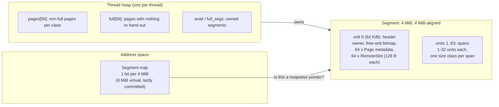

# heapwise design

This document describes how memory is organised, how each operation works, and which
invariants make the lock-free and owner-only paths safe. Function names refer to
`src/heapwise.cpp`; layout constants live in `src/internal.h`.

## Memory layout

- **Segments** are 4 MiB regions aligned to 4 MiB, so `ptr & ~(4 MiB - 1)` gives the segment
  header for any small block: no per-object headers and no lookup table on the free path.
- Each segment has 64 **units** of 64 KiB. Unit 0 holds the header (about 12 KiB, well under
  64 KiB, so most of unit 0 is never touched and never committed).
- A **page** is a span of 1–32 contiguous units serving a single size class. Every unit
  records the index of its span's head, so `pages[pages[unit].head]` finds the metadata
  in two loads.
- **Size classes**: 16..256 bytes in 16-byte steps, then four classes per power of two up to
  256 KiB (56 classes). Internal fragmentation above 256 bytes is at most 25% (tested
  exhaustively for every size in `test_classes.cpp`). A page spans enough units for at least
  8 blocks.
- **Huge objects** (> 256 KiB) get their own 4 MiB-aligned mapping with the same header type
  (`SegmentKind::kHuge`), so `free` still finds metadata by masking. The object starts 64 KiB
  into the mapping, or at `alignment` for larger alignments (up to 2 MiB).
- The **segment map** is a global bitmap with one bit per 4 MiB of a 48-bit address space.
  It lets `hw_free` reject foreign pointers with a diagnostic instead of corrupting memory,
  and backs `hw_owns`.

## Thread heaps and ownership

Each thread gets a `Heap` (from an mmap-backed pool, never from `malloc`) the first time it
allocates. A heap owns segments; `Segment::owner` points at the owning heap.

**Ownership rule:** only the owning heap reads or writes a page's non-atomic fields (`free`,
`used`, list links, ...). Every other thread touches exactly one field of a page it does not
own: the atomic `RemoteSlot::head` for that page.

### malloc

1. `SizeClass(n)`: a branch and a few shifts.
2. Look up the thread's heap. On Apple arm64 this reads the pthread TSD slot directly
   (`TsdBase()[key]`), avoiding the dyld TLV thunk that `thread_local` uses on macOS. The TSD
   layout is checked at startup and the code falls back to `thread_local` if the check fails.
3. Pop from `heap->pages[class]->free`. No atomics, no locks.

The slow path (`MallocSlow`) walks the class queue. For each page it collects remote frees,
carves more blocks (`PageExtend`, about 4 KiB at a time so fresh pages commit memory lazily),
or moves the page to the full list. If no page has space, it may rescan the full list (see
below), then allocates a new span from an owned segment (`PageAlloc`), a cached empty
segment, an abandoned segment (adoption), or the OS.

### free

1. Mask to the segment; check the segment-map bit (foreign pointers abort, or are ignored
   under `LD_PRELOAD`).
2. Huge segment: return the mapping to the huge cache or unmap it.
3. Find the page through the head index. If `segment->owner == current heap`, push onto
   `page->free` and decrement `used`, with no atomics.
4. Otherwise push onto the page's `RemoteSlot` with a CAS loop (a Treiber stack push).

### Cross-thread frees

Remote frees are pushes onto a per-page lock-free stack. The owner never pops individual
nodes: `PageCollect` takes the whole stack with one `exchange(nullptr)`, counts it, and
splices it onto the local free list. With push-only producers and a take-all consumer there
is no ABA problem. Memory ordering: the push is a `release` CAS (it publishes the block's
`next` field), the take is an `acquire` exchange.

Each `RemoteSlot` is 128-byte aligned (the Apple M-series cache line), so remote frees to
different pages do not false-share with each other or with the owner's page metadata.

### Full pages, rescans, and hysteresis

A page whose free list is empty and fully carved moves to the class's full list, so the
allocation path never walks it again. Two mechanisms bring it back:

- **Local frees.** A full page rejoins the queue once 1/8 of its blocks are free. Without
  this hysteresis, a single free moves the page to the queue head, the next malloc empties it,
  and it moves straight back. In a profile of single-threaded Larson, that churn was the largest
  slow-path cost.
- **Remote frees.** The owner learns about these only by looking. `ScanFull` collects every
  full page's remote stack. A scan is triggered when the heap has allocated as many fresh
  pages since the last scan as that scan failed to reclaim (`scan_budget`). When most pages
  come back (producer/consumer patterns), scans happen almost immediately. When nothing comes
  back (a heap that is only growing), the budget doubles and the scan cost stays amortised
  O(1) per page allocation.

An earlier version set the budget to the full-list length after every scan. Pages returned
by a scan refill and rejoin the full list, so the list came back just as long and the heap
had to allocate that many fresh pages before the next scan. The heap doubled every cycle:
2.4 GB peak RSS for about 1 MB of live data in a 4-pair producer/consumer run
(`bench/results/history/`). The regression
test `Threads.ProducerHeapStaysBoundedUnderRemoteFrees` keeps mapped memory below 64 MiB.

### Retiring pages and segments

When a page's `used` reaches 0 it is returned to its segment's free-unit bitmap, unless it is
the only page in its class (to avoid thrashing at a working-set boundary). When every unit of
a segment is free, the heap keeps one segment as a cache (purged with `MADV_FREE_REUSABLE` /
`MADV_DONTNEED`) and unmaps the rest.

A page's span is released only when `used == 0` **after** collecting remote frees. A remote
free in flight refers to a block that is still counted in `used`, so a span can never be
released while another thread is about to push into its `RemoteSlot`.

### Thread exit: abandonment and adoption

A pthread key destructor (`ThreadExit`) runs when a thread exits. It collects remote frees,
releases empty spans, unmaps empty segments, and pushes the rest onto a global
**abandoned list** with `owner = nullptr`. Frees into an abandoned segment from any thread
take the remote path because `owner` matches nobody.

Abandoned segments are adopted in three places:

- `SegmentAcquire`: a heap that needs a new segment adopts one before calling `mmap`.
- `TryAdoptOnFree`: a thread freeing into an abandoned segment takes it over, so its
  remaining frees into that segment are local. Safe because the caller holds a live block in
  the segment, so the segment cannot be released concurrently.
- `hw_collect(1)`: adopts everything, so the memory can be reclaimed on demand.

Adoption (`Adopt`) rebuilds the heap's queues from the page table. Pages that turn out to be
empty are released on the spot.

**Why `owner == my heap` cannot be a false positive after heap reuse.** Heaps are recycled
through a mutex-protected pool. A dying thread stores `owner = nullptr` on every segment it
abandons *before* releasing its heap to the pool under the mutex. A new thread that receives
the same `Heap*` acquires that mutex, so it observes those stores and can never see a stale
owner equal to its own heap.

## Huge allocations

Allocations over 256 KiB are rare and large, so they bypass the heaps. Each gets its own
mapping. Freed mappings up to 64 MiB go into a 16-slot global cache (256 MiB total, guarded
by a mutex), purged on insertion. A request reuses a cached mapping only if it wastes at most
half the request, which bounds how much memory reuse can leak.

## Concurrency summary

| State | Writers | Readers | Protection |
|---|---|---|---|
| Page fields (`free`, `used`, links) | owning heap | owning heap | ownership rule |
| `RemoteSlot::head` | any thread (push) | owner (exchange) | atomic CAS / exchange |
| `Segment::owner` | owner on abandon; adopter | any thread on free | atomic; heap reuse ordered by pool mutex |
| Abandoned list, `Segment::abandoned` | exiting threads, adopters | adopters | `g_abandon_mu` |
| Heap pool | thread start/exit | thread start | `g_heap_mu` |
| Huge cache | any thread | any thread | `g_huge_cache.mu` |
| Segment map | segment create/destroy | `free`, `hw_owns` | atomic bit ops |

`pthread_atfork` handlers take all three mutexes around `fork()`, so a child of a
multithreaded parent can allocate.

## Platform notes

- **Linux**: `libheapwise_override.so` defines `malloc`, `free`, `calloc`, `realloc`,
  `memalign`, `aligned_alloc`, `posix_memalign`, `valloc`, `pvalloc`, and
  `malloc_usable_size` for use with `LD_PRELOAD`. It uses initial-exec TLS. Set
  `HEAPWISE_HUGEPAGES=1` to `madvise(MADV_HUGEPAGE)` each segment: segments are 4 MiB aligned,
  so each one covers exactly two 2 MiB huge pages.
- **macOS**: use the `hw_*` API. Replacing the system allocator on macOS means registering a
  malloc zone, because system frameworks call `malloc_zone_*` directly and would pass
  heapwise pointers to the system zone. That is out of scope.
